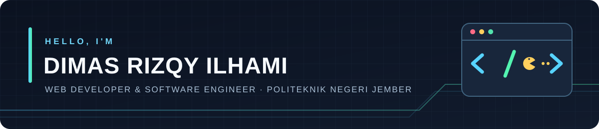

 
 

 

<!-- animated contribution graph: real data, boxes reveal cell by cell
     (regenerated daily by .github/workflows/update-profile-art.yml) -->

 
 

<table>
<tr>
<td valign="top" width="50%"></td>
<td valign="top" width="50%"></td>
</tr>
</table>

 

<b>Web Developer &amp; Software Engineer · Informatics Management Student at Politeknik Negeri Jember</b>

 

